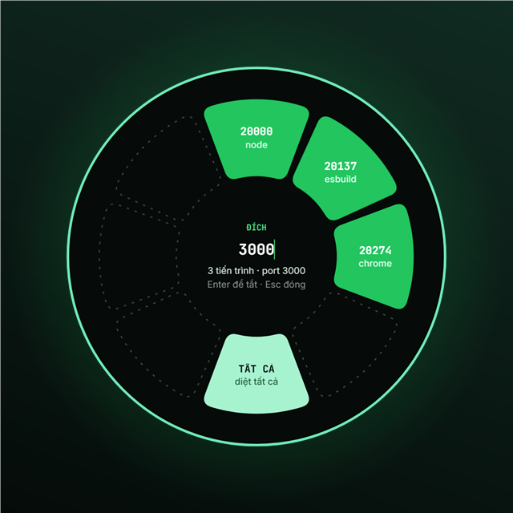
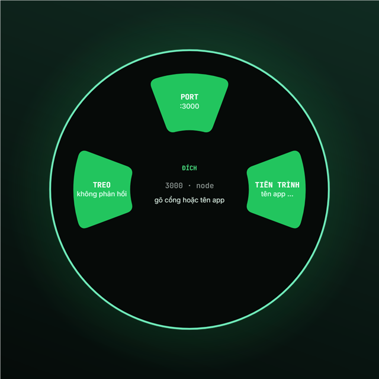

<div align="center">
  
  <h1>PortZap</h1>
  <p><b>Đĩa lệnh giữa màn hình để giải phóng port trong 1 giây.</b><br>
  Bấm <b>Alt+K</b> → gõ <code>:3000</code> → <b>Enter</b> → port sạch.</p>
  <p>
    Windows 10/11 · Tray app · Tiếng Việt &amp; English · Mã nguồn mở (MIT)
  </p>
</div>

<p align="center">
  
</p>

<p align="center">
  
</p>

## PortZap là gì?

Dev server báo `EADDRINUSE` rồi? Không cần mở Task Manager, không cần lục `netstat`.
**PortZap** là overlay tròn nhỏ nằm trong system tray, mở ra bằng một phím tắt và cho
bạn diệt tiến trình đang giữ port — ngay tại chỗ, không rời bàn phím.

Ưu tiên số 1 của dự án là **nhanh**: mục tiêu mở overlay **< 100ms** từ lúc bấm hotkey.
Không quét file, không tính toán rườm rà, chỉ đọc bảng kết nối của Windows.

## Tính năng

- **Mở bằng Alt+K** — đĩa lệnh hiện giữa màn hình, gõ là chạy.
- **`:3000`** — liệt kê tiến trình đang giữ cổng 3000 (tên, PID, RAM) → Enter để diệt.
- **`node`** — liệt kê mọi tiến trình theo tên → Enter để diệt cùng lúc.
- **`hang`** — bắt app *"Not Responding"* → force kill ngay.
- **Tự nhận diện chế độ**: gõ gì cũng được, PortZap tự đoán bạn muốn tra port hay tra tên.
- **Thông báo toast** sau mỗi lần diệt (bao nhiêu PID, có bị từ chối quyền không).
- **Thay đổi ngôn ngữ ngay trong tray** — tiếng Việt / English, không cần restart.
- **Khởi động cùng Windows** (tắt mặc định), tùy chọn ngay trong menu tray.
- **Không hiện thanh tác vụ** — overlay tự ẩn, chỉ hiện khi bạn gọi.

## Cách dùng

| Phím | Việc |
| --- | --- |
| `Alt+K` | Mở / đóng overlay |
| `Enter` | Diệt tiến trình đang được chọn |
| `Esc` | Đóng overlay |

| Lệnh | Ý nghĩa |
| --- | --- |
| `:3000` hoặc `3000` | Các tiến trình giữ port 3000 |
| `node`, `chrome`, `Code`… | Các tiến trình trùng tên |
| `hang` | App đang treo (Not Responding) |

Menu chuột phải vào icon trong tray: **Ngôn ngữ** · **Khởi động cùng Windows** · **Thoát**.

## Tải về

Tải bản mới nhất tại [**GitHub Releases**](../../releases/latest) → giải nén → chạy `portzap.exe`.

- Portable, không cài đặt, không ghi registry ngoài key autostart (nếu bạn bật).
- Windows 10/11 x64 · WebView2 (có sẵn trên Win11, [tải riêng](https://developer.microsoft.com/microsoft-edge/webview2/) nếu dùng Win10 bản cũ).
- Lần đầu chạy có thể bị Smart App Control chặn (exe chưa có reputation) — thử lại sau,
  hoặc build lại từ source trên máy bạn.

Cài đặt ở: `%APPDATA%\portzap\settings.json` (ngôn ngữ + autostart).

## Xây dựng từ nguồn

**Yêu cầu:** [Rust 1.90](https://rustup.rs/) (đã pin trong `rust-toolchain.toml`),
Node.js 20+ *chỉ cần khi bạn sửa UI*.

```powershell
git clone https://github.com/GlyphNomad/PortZap.git
cd PortZap

# Build bản release (ui/dist đã được commit nên không cần Node)
cargo build --release

target\release\portzap.exe
```

Sửa UI thì chạy thêm (bắt buộc sau khi đổi `ui/index.html`, `ui/app.js`, `ui/input.css`):

```powershell
cd ui
npm install        # lần đầu
npm run build      # sinh ui/dist/ — hoặc npm run watch khi dev
```

Kiểm thử:

```powershell
cargo test
cargo clippy --all-targets
```

> **Quy tắc vàng:** không sửa tay trực tiếp trong `ui/dist/` — nó được sinh từ `ui/` và
> nhúng thẳng vào exe. Sửa nguồn rồi chạy `npm run build`, rồi commit kèm file dist.

## Cấu trúc dự án

```
├── src/
│   ├── main.rs        entry, mở overlay, nối các module
│   ├── hotkey.rs      đăng ký Alt+K (RegisterHotKey)
│   ├── port.rs        tìm tiến trình giữ port (GetExtendedTcpTable)
│   ├── proc.rs        tra cứu & diệt tiến trình (taskkill /F /T)
│   ├── hang.rs        phát hiện app Not Responding
│   ├── commands.rs    parse lệnh người dùng (port / tên / hang)
│   ├── tray.rs        icon tray + menu (vẽ icon bằng code)
│   ├── toast.rs       toast Windows
│   ├── settings.rs    settings.json + autostart (registry Run)
│   └── i18n.rs        chuỗi tiếng Việt / English
├── ui/
│   ├── index.html     markup overlay
│   ├── app.js         vòng petal, render kết quả, giao tiếp Tauri
│   ├── input.css      bảng màu (Tailwind 4 + biến CSS)
│   └── dist/          file sinh tự động — đừng sửa tay
├── icons/             icon app (icon.ico đa kích cỡ, icon.png)
├── make_icon.ps1      sinh lại icon
├── tauri.conf.json    cấu hình cửa sổ / identifier
└── RELEASING.md       quy trình phát hành bản mới
```

## Đổi giao diện

- **Màu**: `ui/input.css` → biến `--acc`, `--acc-bright`, `--tint`, `--rim`, `--bg`
  rồi chạy `npm run build`.
- **Icon**: sửa hàm vẽ trong `make_icon.ps1` rồi chạy
  `powershell -ExecutionPolicy Bypass -File make_icon.ps1`
  (icon trong tray vẽ cùng hình ở `src/tray.rs`).

## Đóng góp

Fork → nhánh → sửa → kiểm tra trước khi mở PR:

```powershell
npm run build      # nếu có thay đổi UI
cargo test
cargo clippy --all-targets
```

Mọi lỗi và đề xuất đều welcome qua [Issues](../../issues).

## Giấy phép

[MIT](LICENSE) © PortZap contributors.
